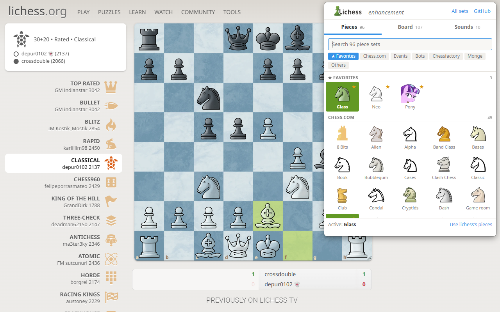
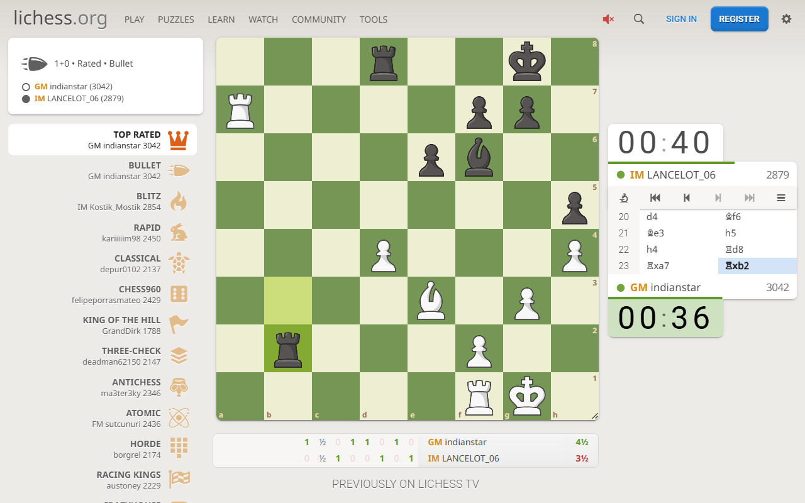
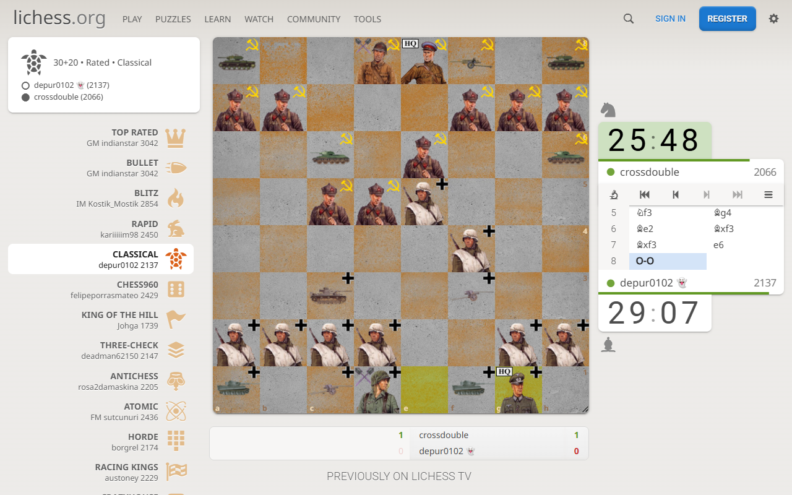
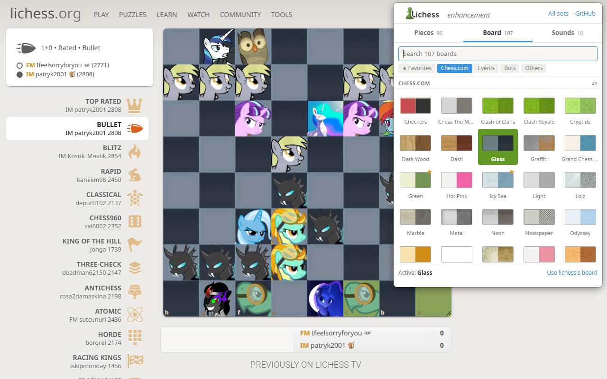
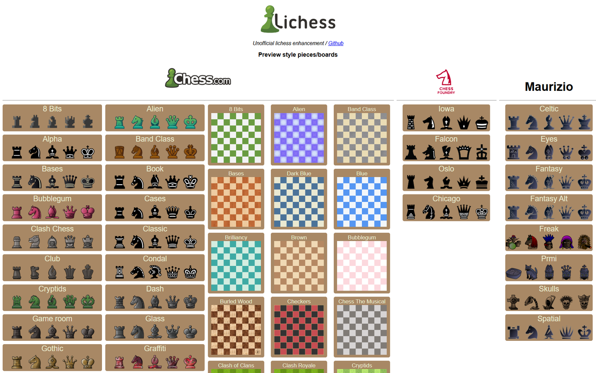

<h1 align="center">
  
</h1>

♟️ New pieces, boards and sounds for <a href="https://lichess.org">lichess.org</a>, including the chess.com styles.

  

---

## Features

- **96 piece sets** — chess.com (2D and 3D, plus the event, sports and bot sets), Chessfactory, Maurizio Monge, and community sets (Amogus, Doge, Pony…)
- **107 board themes** — chess.com boards (including event, sports and bot boards) plus a few extras
- **10 sound sets** — replaces the lichess move / capture / check / checkmate sounds with chess.com sound themes. A move that gives check plays only the check sound, and the chess.com default set adds castle and game-start sounds
- **A visual popup** — every set with a picture and its name, a search field and one section per source. Hover a set to see it on the lichess board, click to keep it. The sound sets have a ▶ to listen
- **Favorites** — ★ a set to pin it at the top of the popup
- **In step with lichess's menu** — while an extension set is on the board, lichess's own choice (your menu › Piece set / Board) is no longer highlighted; picking one of lichess's sets there gives the board back to lichess
- **Keyboard shortcuts** on lichess — <kbd>Alt</kbd>+<kbd>Shift</kbd>+<kbd>←</kbd>/<kbd>→</kbd> previous / next piece set, <kbd>Alt</kbd>+<kbd>Shift</kbd>+<kbd>↑</kbd>/<kbd>↓</kbd> previous / next board (<kbd>⌥</kbd>+<kbd>⇧</kbd> on macOS). With two favorites or more, they cycle through your favorites
- A **preview page** showing every piece set and board (link inside the popup)

Every change applies immediately to all open lichess tabs and syncs across your devices.

## Screenshots

| | |
|:---:|:---:|
|  Neo · Green |  Wehrmacht vs Soviet Union · Graffiti |
|  Pony · Glass, Board tab |  The preview page |

## Installation

### Chrome / Edge / Brave

Install from the [Chrome Web Store](https://chromewebstore.google.com/detail/lichess-enhancement/ikmpcihcohdjammgkopfgohojdelmfoi) — the listing is maintained from this repository.

Store review can make the listing lag a few days behind this repo. To run the latest version right away, install it unpacked:

1. Download the repo (**Code → Download ZIP**) and unzip it, or `git clone` it.
2. Open `chrome://extensions` and enable **Developer mode** (top right).
3. Click **Load unpacked** and select the extension folder.

### Firefox

Install from [Mozilla Add-ons](https://addons.mozilla.org/en-US/firefox/addon/enhancement-lichess/) — the extension is reviewed and signed by Mozilla. Requires Firefox 140+ (desktop and Android).

Firefox treats host permissions as opt-in: open the popup and click **Grant access to lichess.org** the first time (the banner only appears while access is missing).

AMO review can make the listing lag a few days behind this repo. To run the latest version right away, load it temporarily: open `about:debugging` → **This Firefox** → **Load Temporary Add-on** and pick `manifest.json`.

## How it works

- **Pieces and boards**: a content script injects a stylesheet on lichess pages that overrides the piece sprites (`piece.<color>.<role>`) and the board texture (`cg-board::before`) with images bundled in the extension. The choices live in `storage.sync`; every lichess tab re-applies them when they change.
- **Popup**: `ressources/js/catalog.js` lists every set; `ressources/js/gallery.js` builds the picker. Only the open tab is built, and each tab's thumbnails come from a single sprite sheet (`ressources/thumbs/pieces.webp`, `boards.webp`), so the popup opens fast. Previews only swap the stylesheet, without saving; they go through a port to the tab, so closing the popup restores the saved sets.
- **Lichess's menu**: `ressources/js/dasher.js` watches clicks on lichess's own piece sets / boards and gives the board back to lichess.
- **Sounds**: `declarativeNetRequest` rules redirect the lichess sound files (`Move`, `Capture`, `Check`, `Checkmate`) to the mp3 files of the selected sound set. No network request leaves the extension: everything is served locally. A small script running in the lichess page (`ressources/js/soundHook.js`) wraps lichess's sound player to pick a single sound per move, and plays `Castle` / `GameStart` (redirected the same way) with the chess.com default set.

## Contributing

Bug reports and new sets are welcome — open an [issue](https://github.com/basedpolymer/lichess_enhancement/issues) or a pull request. To add a piece set, drop 12 files named `bb, bk, bn, bp, bq, br, wb, wk, wn, wp, wq, wr` (`.webp`) in `ressources/pieces/<set_name>/` (lowercase folder name), then add a line for it in `ressources/js/catalog.js`, run `node scripts/buildThumbs.js` to make its thumbnail and the sprite sheets (needs `cwebp`, from libwebp, and `ffmpeg`) and `node scripts/buildPreview.js` to regenerate the preview page (`ressources/preview/index.html`). Boards work the same way: `ressources/boards/<board_name>.webp`. Convert a PNG losslessly with `ffmpeg -i wq.png -c:v libwebp -lossless 1 wq.webp`. `scripts/downloadStylesFromChesscom.py` can help fetching chess.com styles.

## Credits & legal

Piece and board artwork and sounds belong to their respective authors — see [`ressources/pieces/credits.md`](ressources/pieces/credits.md) and [`ressources/boards/credits.md`](ressources/boards/credits.md). This is an unofficial project, not affiliated with lichess.org or chess.com.
